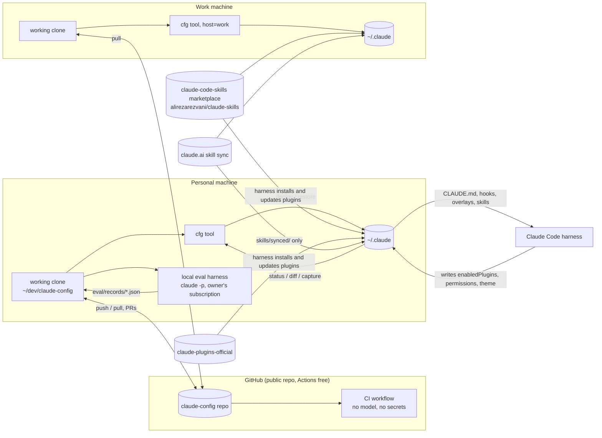
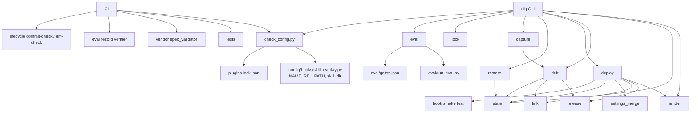
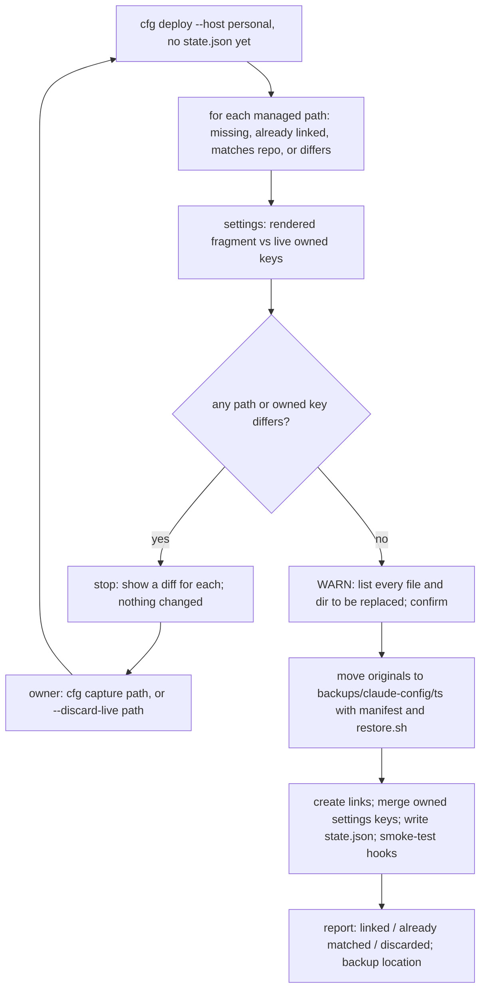
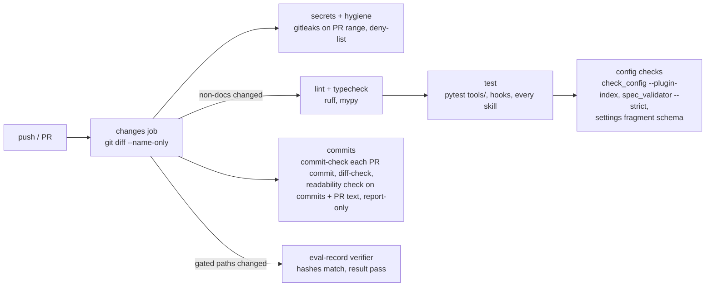

# claude-config architecture

This repository will become the source of truth for one person's Claude Code configuration. Today that configuration lives only in `~/.claude`, where it was installed on 2026-10-15. The repo lets the owner track, review, test and redeploy it from git on two machines. This document explains how the repo is laid out, how its tooling deploys and rolls back the configuration, how changes are checked, and what could go wrong. Read it before working on the repo or approving its build plan.

Status: accepted by the owner on 2026-10-16. From here on, these documents and the ADRs are the source of truth, and any departure needs a new or updated ADR. Nothing has been built, committed or deployed yet. Each decision is recorded in an ADR (architecture decision record), from [ADR-0001](../adr/0001-deployment-model.md) to [ADR-0010](../adr/0010-prose-for-people.md). The build plan and the remaining open questions are in [plan.md](plan.md).

The configuration being moved into the repo is:
- the global CLAUDE.md (version 2);
- seven overlays;
- two hooks;
- the `settings.json` keys those hooks and plugins need;
- two custom skills, `github-issue-lifecycle` and `linux-troubleshooting`.

Two new prose skills are planned on top of that.

## Terms

| Term | Meaning |
|---|---|
| live config | The files Claude Code reads at run time, under `~/.claude` |
| payload | Everything in the repo's `config/` directory: the only files that reach the live config |
| `cfg` | The repo's command-line tool that checks, deploys, diffs and rolls back the live config |
| release worktree, `current` | A git worktree checked out at one deployed commit, under `~/.local/share/claude-config/releases/<sha>/`. `current` is a symlink to the release in use. The live config links point through it. |
| first deploy | The first `cfg deploy` on a machine that already has the configuration installed. It stops on any file that differs from the repo until the owner decides about it, then backs the live files up and replaces them with links. It replaced hash-verified adoption on 2026-10-18. |
| drift | Any difference between the live config and the deployed commit, such as an edit made through a link |
| overlay | A per-skill policy file that a hook injects into the conversation when that skill loads |
| the lifecycle skill | The skill that runs the tracker side of a piece of work: `github-issue-lifecycle` for GitHub issues, or `jira-ticket-lifecycle` for Jira tickets ([ADR-0011](../adr/0011-tracker-agnostic-lifecycle.md)). Which one applies comes from the repo's CLAUDE.md, then a machine-local override, then the host profile. |
| host profile | A JSON file in `hosts/` that lists which payload components a given machine receives |
| plugin lock | `plugins.lock.json`, a record of the installed plugin versions and the skill files the payload refers to |
| scenario eval | A local comparison that runs fixed prompts through headless `claude -p` against the old and new global CLAUDE.md and grades the answers |
| eval record | A committed JSON file holding the result of a local eval run, plus sha256 hashes of the files it tested |
| clause inventory | `eval/clauses.json`, which maps every rule in the CLAUDE.md to the file that must contain it, so no rule is lost silently |
| the v2 spec | The approved specification for the layered CLAUDE.md, overlays and hooks. It lives beside the payload it documents, as `config/SPEC.md` |

## What was checked before designing

The design starts from these facts, each verified on the owner's machine on 2026-10-15 or 2026-10-16.

| Fact | How it was checked |
|---|---|
| All 34 files listed in the version 2 install manifests still match `~/.claude` byte for byte. That is 10 files in `deliverable-manifest.sha256` (CLAUDE.md, seven overlays, two hooks) and 25 lifecycle-skill files in `bundle-manifest.sha256`. | `sha256sum -c` against `~/.claude/backups/claude-md-v2-20261015T230435/` |
| `settings.json` differs from its pre-install backup only by the three hook entries. Their commands use absolute paths (`python3 -I /home/mfracker/.claude/hooks/…`). | Semantic JSON diff |
| The staged lifecycle skill equals the installed one, apart from `SPEC.md` and `REVIEW-NOTE.md`, which exist only in the live copy. | `diff -rq` |
| The version 2 implementation's tests pass (93). The lifecycle skill's tests pass except one (80 pass, 1 fails): `test_nothing_that_could_trigger_is_installed_yet`, a check from before installation that is now false by design. | `python3 -I -m pytest` |
| The spec validator's strict mode scores the lifecycle spec at 96 and the retired skill's spec at 100. | `spec_validator.py --strict` from the installed engineering-advanced-skills 2.9.0 |
| Four files contain absolute `/home/mfracker` paths: `install_v2.py`; `eval/run_eval.py` (including a plugin-version path and a temp directory under `~/.claude/jobs/`); the lifecycle skill's `evals/run_behaviour_evals.py` (which points at the scratch build); and the lifecycle `SPEC.md`. | `grep` |
| No file proposed for import contains an email address or token. | `grep` with the email and token patterns from the v2 spec's quality check (AC-4), plus the account email |
| The GitHub repo `Towerism/claude-config` already exists, is public and is empty, and `origin` points at it. On 2026-10-16 the owner decided it stays public. | `gh repo view` |
| The pipeline skill's stack detector finds no signals yet, because the repo has no `pyproject.toml`. CI commands therefore come from the scripts themselves, and the detector is run again once `pyproject.toml` exists. | `stack_detector.py` |
| The lifecycle skill's rule against requirement IDs in code (lifecycle spec FR-16) would fail on this repo's eval data and test fixtures. [ADR-0009](../adr/0009-spec-id-hygiene-for-eval-data.md) resolves this. | Read `cmd_diff_check` and searched the candidate files |
| `~/.claude/CLAUDE.md` loads a second time, through ancestor-directory discovery, for any working directory under `$HOME`. A file named `CLAUDE.md` inside the repo would also load, as project or subdirectory memory. This shapes the repo layout in [ADR-0002](../adr/0002-repo-layout.md). | The harness mechanism check recorded in the v2 implementation's `FR-18a-results.md` |

## How the pieces fit together

The diagram below shows the repo, the two machines that deploy from it, and the other systems that write into `~/.claude`. Only `cfg` writes the payload. The harness, the plugin marketplaces and claude.ai sync each write their own parts.



Every part of `~/.claude` has one owner, and the repo touches only what it owns:

| Part of `~/.claude` | Owner | How the repo treats it |
|---|---|---|
| `CLAUDE.md`, `skill-overlays/`, `hooks/*.py`, `skills/<custom>/` | The repo | Deployed as symlinks into the current release worktree ([ADR-0001](../adr/0001-deployment-model.md)). An edit made through a link counts as drift. |
| `settings.json` | Shared | The repo owns only the keys listed in `config/settings.fragment.json` and merges them atomically ([ADR-0001](../adr/0001-deployment-model.md), settings section). Every other key belongs to the harness or the owner. |
| Plugin code (`plugins/cache`, `plugins/marketplaces`) | Harness and marketplaces | Never versioned. The plugin lock records installed versions so changes can be detected, but the repo can't pin what the harness installs. |
| `skills/synced/`, `skills/.trash/` | claude.ai sync | Never read, written or versioned. `cfg status` reports only a name collision with a repo skill. |
| Credentials, history, transcripts, caches, sessions, jobs, backups and similar | Harness | Never versioned. `.gitignore`, the pre-commit hook and CI enforce a deny-list. |

## Repo layout

Everything that deploys sits under `config/`. Tooling, evals and docs sit beside it and never reach the live config. The global CLAUDE.md is stored as `CLAUDE.global.md` so that it never loads as project memory while someone works in the repo.

```text
claude-config/
├── CLAUDE.md                    project memory for working on this repo (commands, gates); never deployed
├── README.md
├── pyproject.toml               pytest, ruff and mypy settings (no package build)
├── requirements-dev.txt         pinned with hashes: pytest, pytest-cov, ruff, mypy, jsonschema
├── .python-version              3.13 (the minimum: the work machine runs 3.13.5, the personal machine 3.14)
├── .gitignore  .gitleaks.toml
├── .githooks/                   pre-commit (gitleaks, deny-list, email and token patterns), pre-push (refuses main)
├── .github/workflows/ci.yml
│
├── config/                      the payload: the only directory that reaches ~/.claude
│   ├── CLAUDE.global.md         → ~/.claude/CLAUDE.md
│   ├── skill-overlays/*.md      → ~/.claude/skill-overlays/
│   ├── hooks/*.py               → ~/.claude/hooks/
│   ├── settings.fragment.json   settings keys the repo owns; hook commands use {claude_home}
│   └── skills/<name>/           → ~/.claude/skills/<name>/  (SKILL.md, SPEC.md, REVIEW-NOTE.md, scripts, tests, evals)
│       ├── plain-prose/         planned: readability rules for all prose, plus prose_check.py (ADR-0010)
│       └── writing-docs/        planned: documentation steps, plus doc_lint.py (ADR-0010)
│
├── hosts/
│   └── personal.json            host profiles: personal.json and work.json; they differ only in defaultLifecycle
├── plugins.lock.json            plugin lock: versions, git SHAs, skill names, files the overlays refer to
│
├── tools/                       repo tooling; never deployed
│   ├── cfg/                     commands: check, plan, status, diff, deploy, capture, rollback, restore, lock, eval
│   │   ├── render.py            applies the host profile and {claude_home} to produce the deploy set
│   │   ├── cli.py               the cfg command: plan, status, diff (#6); deploy, rollback, capture, restore (#8)
│   │   ├── release.py           release worktrees, the atomic `current` swap, removing a pruned release
│   │   ├── link.py              warn, back up, link; checks that links are intact
│   │   ├── settings_merge.py    merges owned keys, idempotent and atomic (grown from install_v2.py)
│   │   ├── state.py             deploy state, sha256 manifests and the cfg lock
│   │   ├── errors.py            the error types the command line turns into exit code 2
│   │   ├── drift.py             status, plan and diff: the release's git status, link checks, owned settings keys
│   │   ├── deploy.py            deploy and rollback: conflicts, the release checks, the hook smoke test, backups, pruning
│   │   ├── capture.py           live changes written into a feature-branch worktree, never committed
│   │   ├── restore.py           the standalone undo copied into every deploy backup; standard library only
│   │   ├── lock.py
│   ├── check_config.py          the ported config checker, with an offline mode that reads the plugin lock
│   └── vendor/claude-skills/spec_validator.py  plus VENDORED.json (source, version, sha256, MIT licence)
├── schemas/                     a vendored snapshot of the settings schema, plus a schema for the fragment
├── tests/                       pytest for tools/ and config/hooks (each skill keeps its own tests)
│
├── eval/                        model evals, run locally only; CI only verifies their records
│   ├── clauses.json             the clause inventory
│   ├── scenarios.json           19 scenarios for the scenario eval (v2 spec AC-6)
│   ├── gates.json               which changed paths require which eval suites
│   ├── run_eval.py  hook_harness.py
│   ├── symlink_check.py         checks that Claude Code follows the deploy's symlinks (ADR-0001); not a gated suite
│   ├── records/<suite>.json     committed eval records
│   └── out/                     raw transcripts, gitignored
│
└── docs/
    ├── architecture/  adr/  runbook.md
    ├── evidence/                results of one-off checks, such as symlink-check.md
    └── history/                 frozen spec revisions, review diffs, selected evidence, the retired skill
```

The module diagram shows which parts of the tooling depend on which. An arrow means "imports or reads".



Outside the repo, every machine also keeps some `cfg` state:

```text
~/.local/share/claude-config/
├── releases/<sha>/   one release worktree per deployed commit (the last 5 are kept, plus any with edits)
└── current -> releases/<sha>
~/.claude/CLAUDE.md, skill-overlays, hooks/<file>.py, skills/<name>  → symlinks through current/config/…
~/.claude/backups/claude-config/<ts>/  originals moved aside before linking, with a manifest and restore.sh
```

A copy of `restore.py`, a standalone stdlib script, goes into every backup directory, the same way `install_v2.py` copies itself today. That keeps rollback working when the repo is broken or missing.

## Deploying

`cfg deploy` makes a new release worktree for the target commit, checks it, and then switches `current` to it in one atomic step. It builds the release from the commit (`origin/main` as last fetched, or `--ref`) and never reads the clone's working tree, so a dirty tree or a checked-out branch can't reach the live config. The sequence below includes the two places where it stops: conflicts it found before changing anything, and the change list it shows before going ahead. Decisions are in [ADR-0001](../adr/0001-deployment-model.md) and [ADR-0004](../adr/0004-drift-and-adoption.md).

```mermaid
sequenceDiagram
  actor U as Owner
  participant C as cfg deploy
  participant G as git
  participant R as releases/
  participant L as ~/.claude
  U->>C: cfg deploy --host personal [--ref <sha>] [--discard-live <path>]... [--yes]
  C->>G: resolve origin/main as last fetched (or --ref); read its config/ and hosts/
  C->>L: classify each managed path; compare owned settings keys
  C->>R: edits in the deployed release that the target lacks?
  alt any conflict not passed with --discard-live
    C-->>U: stop (exit 1): a diff per conflict; resolve with cfg capture or --discard-live
  end
  C->>R: git worktree add --detach releases/<sha> (or reuse a clean one)
  C->>C: the release's own config checker; hook smoke test against the release
  C-->>U: the change list; continue? [y/N] (--yes skips; no terminal means stop)
  C->>L: backups/claude-config/<ts>/: restore.py, restore.sh, restore.json
  C->>L: move what is in the way into the backup, manifest first
  C->>R: swap current -> releases/<sha> (temp link + os.replace)
  C->>L: create links through current/; remove cfg links that left the profile
  C->>L: settings merge: owned keys only, re-read before os.replace, skip if unchanged
  C->>C: write state.json; hook smoke test through the live commands; prune releases
  C-->>U: deployed <sha>; undo: cfg rollback (or backups/…/restore.sh)
```

The version 2 installer's safety requirements (v2 spec FR-23) carry over as invariants, and each one keeps a test:

1. Preflight before any change. Abort if `settings.json` is malformed, isn't a JSON object, or is a symlink. Any path in the way of a link triggers the warning, and if that path's content differs from the repo, deploy aborts unless the owner passes `--discard-live`.
2. Back up before deleting or replacing anything; the owner set this rule on 2026-10-16. After the first change, any unexpected error exits non-zero and names `restore.sh`.
3. In `settings.json`, change only owned keys, keep everything else semantically equal, and write atomically (temp file in the same directory, then `os.replace`). The merge is also idempotent. `install_v2.py` appended hook entries unconditionally, while `cfg` ensures exactly one handler per event, matcher and command.
4. Keep a sha256 manifest of everything moved aside.
5. Restore without destroying anything. It acts only on manifest paths, only where a link still points where `cfg` put it, and removes only its own settings entries.

## First deploy on a machine that already has the config

The first `cfg deploy` on a machine where the configuration is already installed takes it over without losing anything. It compares every managed path with the repo and stops on any difference until the owner decides about that path. Then it backs up the live files and replaces them with links. [ADR-0004](../adr/0004-drift-and-adoption.md) records the decision, which replaced hash-verified adoption on 2026-10-18.



The diagram shows the loop at the start: every difference sends the owner back to resolve it, and nothing changes on disk until no differences remain. `cfg capture <path>` puts the live version on a feature branch for review. `--discard-live <path>` accepts the repo's version, and the live file still goes into the backup. `settings.json` is resolved the same way when its owned keys differ.

Skill directories that aren't listed in the host profile are never read, reported, copied or touched. The first deploy also leaves the `claude-md-v2-*` backup unchanged. The owner doesn't intend to return to version 1, so once the first deploy passes, that backup and the retired skill in `~/.old-claude/skills/issue-spec-driven-workflow/` have no rollback role. Issue 8 lists the two paths and deletes them after the owner's go-ahead.

## Drift: status, diff and capture

`cfg status` compares the live config with the deployed commit and reports one of the states below. `cfg diff` shows the differences as unified diffs.

| What `cfg` sees | State | What to do |
|---|---|---|
| Links intact, `current` is the release for the tip of `main`, release worktree clean | clean | Nothing |
| `main` is ahead of the deployed release | behind | `cfg deploy` |
| The release worktree has edits made through a link, for example by `/revise-claude-md` | drift | `cfg capture` on a feature branch, then a PR through the normal gates. Or `cfg deploy --discard-live`, which leaves the edited release on disk. |
| A managed path is a plain file or directory, because a tool replaced the link | unlinked | Capture it, or relink after a warning and a backup |
| A link is missing or points elsewhere | broken | `cfg deploy` re-links |
| Owned settings keys differ from the last deploy | settings drift | Capture into the fragment, or redeploy |

`cfg status` also reports three warnings that don't fit the table. A plugin version may differ from the plugin lock. A synced skill may share a name with a repo skill. Or `current` may point at a commit other than the tip of `main`.

Deploy always installs the repo's version, and it never throws away a live edit without an explicit command. `capture` turns the edit into a reviewed commit. `--discard-live` deploys anyway and leaves the edit in the old release worktree. Nothing commits on its own.

## Rolling back

Most mistakes are fixed with a git revert and a normal deploy. The faster paths are for a deploy that breaks Claude Code itself, when there may be no working Claude session to make a PR with. [ADR-0006](../adr/0006-repo-workflow.md) records the decision.

| Situation | Procedure |
|---|---|
| A merged change is wrong, but Claude Code still works | `git revert <sha>` on a `fix/` branch, then PR, merge and `cfg deploy`. History stays honest. |
| A deploy broke Claude Code itself, for example a hook that crashes on every tool call | `cfg rollback`, which points `current` back at the previous release in one atomic swap and fixes `cfg`'s own links. It leaves `settings.json` alone and prints the `cfg deploy --ref` command that also rolls the owned settings back when they differ. If `cfg` can't run: `ln -sfn releases/<previous-sha> ~/.local/share/claude-config/current`, or the backup's `restore.sh`. Follow up with the revert PR. |
| Undo the first deploy completely and return to plain files | `~/.claude/backups/claude-config/<first-deploy-ts>/restore.sh`. It removes the links it made and moves the originals back, checking hashes first. |
| A known-good state is needed now, without waiting for a PR | `cfg deploy --ref <good-sha>`. `cfg status` keeps flagging the non-HEAD release until `main` catches up through the revert PR. |

## CI and eval gates

GitHub Actions runs every check that needs no model and no credentials. The model evals run only on the owner's machine, under the owner's own subscription. They leave committed eval records, and CI checks those records against the PR's files. Decisions are in [ADR-0005](../adr/0005-verification-and-ci.md).



| Gate | Where it runs | How it blocks a merge |
|---|---|---|
| ruff, mypy, pytest (about 175 tests today), config checker, spec validator, settings schema, gitleaks, commit-message check, requirement-ID check | GitHub Actions, free for public repos | CI goes red. These jobs are required checks in the ruleset protecting `main`. |
| Scenario eval, comparing the merge-base config with HEAD | Locally, with `cfg eval` | CI's record verifier requires a record for each required suite, whose input hashes equal the PR head's files and whose result is a pass |
| CLAUDE.md quality rubric | Locally | The same verifier, for CLAUDE.md changes only |
| Hook harness runs (overlay injection with a canary, the merge "ask" prompt) and 95th-percentile timing | Locally | The same verifier, for changes to hooks or hook settings |
| Trigger and behaviour evals for the lifecycle, `plain-prose` and `writing-docs` skills | Locally | The same verifier, when that skill's SKILL.md description or body changes |
| Readability check on commit messages and the PR title and body (`plain-prose`'s cold-reader, readability and AI-tell findings) | GitHub Actions | Never blocks. Findings go to the job summary for the reviewer ([ADR-0010](../adr/0010-prose-for-people.md)). |
| Plugin update (a change to the plugin lock) | Local review | The PR carries notes from `dependency-auditor` and `skill-security-auditor`, and the checker passes against the new lock |

A full run takes about two minutes. A docs-only PR runs only the hygiene job, in about 20 seconds. Public-repo minutes are free, so the constraint is wall-clock time, not cost.

## Threats and safety

The table lists the risks this design guards against, with a rough likelihood and impact for each. Other documents refer to rows by their key (T1 to T10).

| Key | Threat | Likelihood × impact | Controls |
|---|---|---|---|
| T1 | A secret, the owner's email, or an excluded term gets committed (credentials, tokens in an eval transcript, a pasted settings value) | Med × High | Only `config/` deploys. Raw eval output stays in the gitignored `eval/out/`. Eval runs create their temporary config directories under `/tmp` and assert they're outside the repo, because those directories hold a copied `.credentials.json`. gitleaks, the email and token patterns, and the filename deny-list run in pre-commit and again in CI over the PR's commits. Pre-commit also checks a local, untracked list of excluded terms ([ADR-0007](../adr/0007-visibility-and-security.md)). `capture` copies only managed paths. |
| T2 | A hook change breaks or subverts every tool call. Hooks run with the owner's privileges on every Skill and Bash call, and they see full Bash commands. | Low × High | The hook review bar in [ADR-0007](../adr/0007-visibility-and-security.md): a CI check that hooks use only the standard library and no network, 100% branch coverage, a real-harness eval record, 95th-percentile time under 500 ms, always exit 0, never print tool input. Deploy smoke-tests hooks before and after switching. `cfg rollback` and the standalone `restore.sh` are the undo. |
| T3 | Plugin supply chain: a marketplace update changes skill text, or the scripts that overlays tell Claude to run | Med × High | The plugin lock records versions and git SHAs, and `cfg status` and `cfg check --live` flag any change. Each lock update is its own PR with dependency and security audits. The owner keeps marketplace auto-update on (decided 2026-10-16), so the repo detects updates rather than preventing them. |
| T4 | A deploy overwrites settings the harness wrote, or deletes a live file | Med × Med | Only owned keys are merged. The file's hash is re-read just before `os.replace`, and the write aborts if it changed. Nothing is written when the result is semantically unchanged, so the first deploy doesn't rewrite `settings.json` when its owned keys already match. Files are never deleted: after a warning, they are moved into a backup with a manifest. |
| T5 | Unreviewed draft config goes live, from a branch checkout or a dirty working tree | Med × Med | Links point at release worktrees pinned to a deployed commit, never at the working clone. `deploy` installs the commit `origin/main` names, or an explicit `--ref`, and never reads the working tree. Skills live under `config/skills/`, not `.claude/skills/`, so drafts never register as project skills. |
| T6 | Personal content and the owner's email become public | Certain × Low–Med (the owner accepted a public repo) | Everything committed is world-readable, and so is the author email in every commit. The email stays obfuscated: the repo commits with the owner's GitHub noreply address, and CI fails any commit whose author or committer email isn't a noreply address. Secret and email scans run before commit and in CI. Anything that later shouldn't be public moves to a private companion repo. |
| T7 | CI has more access than it needs | Low × Med | `permissions: contents: read`. No secrets. The trigger is `pull_request` only, never `pull_request_target`. Actions are pinned to full commit SHAs, and the gitleaks binary is checksum-verified. |
| T8 | Instructions planted in issue or PR text steer the agent | Low × Med | The lifecycle skill treats issue text as data, not instructions (lifecycle spec FR-23). CI never feeds PR text to a model. |
| T9 | Skills land on a machine where they don't belong | Med × Med | Host profiles list exactly which skills each machine receives. Which skills go to the work machine is still an open question in [plan.md](plan.md). |
| T10 | A merge happens without the owner's click | Low × High | The merge-confirmation hook is unchanged, and the repo's own merges go through it. A pre-push hook refuses pushes to `main`. |
