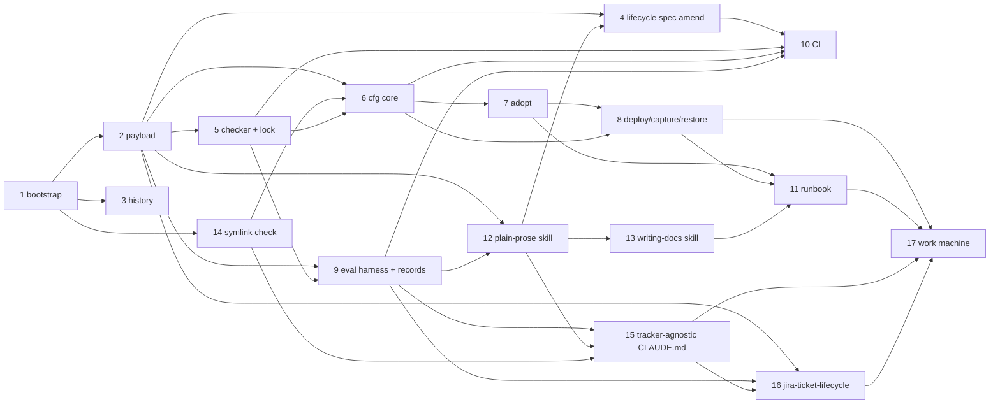

# Build plan and open questions

**Status:** Accepted by the owner on 2026-10-16 (proposed 2026-10-16). At the owner's request, all 17 issues were filed on 2026-10-16 as [#1 to #17](https://github.com/Towerism/claude-config/issues), numbered as in the table below, so a fresh conversation can work on each one. No spec is written yet.

This plan breaks building the claude-config repo into 17 GitHub issues and shows the order they depend on. It also records the approval mode for their specs and lists the questions only the owner can answer. Read it alongside the [architecture doc](README.md), whose [Terms section](README.md#terms) defines words such as payload, `cfg`, release worktree, adoption, plugin lock and scenario eval.

## Proposed issues

Each issue gets one branch and one PR, and goes through the owner's full pipeline (see [ADR-0006](../adr/0006-repo-workflow.md)). The Gates column lists what the PR must show beyond green CI.

| # | Type | Title | Depends on | Scope | Gates |
|---|---|---|---|---|---|
| 1 | chore | Bootstrap the repo: visibility, scaffolding, git hooks, labels, ADRs | — | Set the repo-local `user.email` to the owner's GitHub noreply address before the first commit. Pre-commit checks for a noreply identity and for excluded terms. A ruleset on `main`: PR required, CI required once issue 10 lands, no force-push. Root `CLAUDE.md` (where specs live: issue body for claude-config and coordination changes, `SPEC.md` beside the skill for skill changes, created on a skill's first change; commands, gates, "`gh pr checks` green before merge"), `README.md`, `.gitignore` (the never-versioned paths), `pyproject.toml`, hash-pinned `requirements-dev.txt`, `.python-version`, `.gitleaks.toml`, `.githooks/` (pre-commit, pre-push), the lifecycle skill's labels, and these ADRs and architecture docs. Re-run `stack_detector.py`. | Pre-commit catches a planted fake token and an email address (tested, then reverted) |
| 2 | feat | Import the live config payload into `config/` | 1 | v1 of the global CLAUDE.md (`CLAUDE.md.orig`) as the first commit of `config/CLAUDE.global.md`, then v2 on top. Overlays, hooks, the two managed skills (without caches), `settings.fragment.json` with `{claude_home}`, `hosts/personal.json`. Verified without a script: the `sha256sum` of every `config/` file against the live config and the v2 install manifests, quoted in the PR. | A hash table in the PR: 34 of 34 manifest matches, plus the files compared directly |
| 3 | docs | Import the v2 spec and history artefacts ([ADR-0008](../adr/0008-retiring-scratch.md)) | 1 | The v2 spec and its review note to `config/SPEC.md` and `config/REVIEW-NOTE.md`; `docs/history/{claude-md-v2, github-issue-lifecycle, retired-skills}`, exactly as the ADR-0008 table lists, with no caches or probe output | gitleaks, email and excluded-terms scans on the import commit; no file over 200 KB |
| 4 | fix | Amend the lifecycle skill's spec for life in a repo and for plain prose ([ADR-0009](../adr/0009-spec-id-hygiene-for-eval-data.md), [ADR-0010](../adr/0010-prose-for-people.md)) | 2, 12; ADR-0009, as revised by the owner on 2026-10-16 | `config/skills/github-issue-lifecycle/SPEC.md` first, under its approval mode. The changes: `diff-check` allows a requirement ID when it appears in any form in living documentation, and accepts a spec file that sits next to the thing it documents (lifecycle spec FR-16); retiring the staging requirement (FR-3 and AC-2) along with its stale test; repo-relative eval paths; `plain-prose` applied before every issue, comment, PR and commit; for an issue whose change is to a skill with a `SPEC.md`, the issue body links that spec instead of holding one, and approval is read from the spec's Status line ([ADR-0002](../adr/0002-repo-layout.md)); and report-only tell sections in `commit-check` and `pr-body-check`. Then test-first changes in the skill. | All lifecycle tests passing (81, or the count after the rewrite); a behaviour-suite eval record, because the SKILL.md body or the evals changed |
| 5 | feat | Port the checker with an offline plugin index; vendor the spec validator | 2 | `tools/check_config.py` (committed unchanged, then ported), `--plugin-index`, `cfg lock` to write the plugin lock, `tools/vendor/claude-skills/spec_validator.py` plus `VENDORED.json`, checks per host profile, a rule against `/home/` and scratch paths, and any requirement ID that living documentation doesn't mention removed from code. Its tests. | The checker passes on the real live config, and in a temp home with an empty plugin cache using the plugin lock |
| 6 | feat | `cfg` core: render, release worktrees, linking, owned-key settings merge, state, plan/status/diff | 2, 5, 14 | `tools/cfg/{render,release,link,settings_merge,state,drift}.py`, with the settings and backup code grown from `install_v2.py` (committed unchanged first), plus tests. Idempotent hook merge, a guard against concurrent writes to `settings.json`, drift classification, and a render test for a second host profile. | The rendered hook commands for the personal profile are byte-identical to the live ones; `cfg status` against the live config reports clean once a state file exists |
| 7 | feat | `cfg adopt`: hash-verified adoption of the v2 install | 6 | Adoption as in [ADR-0004](../adr/0004-drift-and-adoption.md): verify hashes, then warn, back up and link. Tests in temp homes built from copies of the v2 manifests: matching, mismatching and missing-manifest cases, plus restoring the originals. Acceptance on the owner's machine: run `cfg adopt` once, with the owner's go-ahead. Content unchanged, files replaced by links, originals in the backup, `settings.json` not rewritten. After adoption passes: list, then delete, the retired skill in `~/.old-claude/skills/issue-spec-driven-workflow/` and `~/.claude/backups/claude-md-v2-*/` (the owner's instruction, 2026-10-16). | The adopt output quoted in the PR; every link resolves to a file whose sha256 matches the v2 manifest |
| 8 | feat | `cfg deploy`, `rollback`, `capture`, standalone `restore` | 6, 7 | The deploy flow from the deploy section of the [architecture doc](README.md): release worktrees, an atomic swap of `current`, warn-back-up-link for anything in the way, a hook smoke test, `--ref`, `--discard-live`, `--target`, release pruning. `rollback`; `capture` (the release worktree's diff applied to a branch); `restore.py` and `restore.sh` written into each backup. The tests for the v2 installer's safety requirements (v2 spec FR-23) are ported and extended. | A temp-home run end to end: deploy, edit through a link, `status` shows drift, deploy refuses, capture, deploy, rollback, and restore puts the original files back byte for byte |
| 9 | feat | Port the eval harness; add gates and eval records | 2, 5 | `eval/run_eval.py` with repo-relative paths, eval directories under `/tmp` asserted to be outside the repo, the old arm taken from the merge-base, and the rubric path read from `installed_plugins.json`. `hook_harness.py`, which runs the v2 spec's real-harness hook checks (AC-7 for the overlay hook, AC-9 for the merge hook). `eval/gates.json`, the record writer, `tools/cfg/eval_records.py verify`, `cfg eval`. | The first real eval records: scenario eval 19 of 19 with no regressions against the merge-base, rubric score of at least 80, `hook-overlay`, `hook-merge` |
| 10 | feat | CI workflow | 4, 5, 6, 9 | `.github/workflows/ci.yml` as described in [ADR-0005](../adr/0005-verification-and-ci.md). Load `ci-cd-pipeline-builder` again before writing the YAML, then add one optimization at a time: baseline jobs, then the pip cache, then path gating. | The workflow-schema check passes; the first PR shows the hygiene and eval-record jobs failing on planted fixtures, then passing |
| 11 | docs | Runbook: deploy, adopt, drift, rollback, bootstrapping a second machine, what to delete | 7, 8, 13 | `docs/runbook.md`, written with `runbook-generator` and `senior-devops`. Includes when the retired skill in `~/.old-claude/skills/issue-spec-driven-workflow/` and the `claude-md-v2-*` backup were deleted after adoption, as the owner instructed. `~/.old-claude/work-skills/` is kept. | The owner walks through it once |
| 12 | feat | `plain-prose` skill, CLAUDE.md line and reviewer overlay line ([ADR-0010](../adr/0010-prose-for-people.md)) | 2, 9 | A new skill in `config/skills/plain-prose/`: its spec-driven-workflow `SPEC.md` first, under its approval mode, then `SKILL.md` and `scripts/prose_check.py` with tests. Vendored from claude-code-skills at commit `19392f7` (MIT): the `content-humanizer` AI-tells checklist, the `copy-editing` plain-English list and `readability_scorer.py`, and `ai_content_detector.py`. Each is committed unchanged first and then adapted, with `VENDORED.json` and an upstream-change report in `cfg check --live`. `skill-security-auditor` runs on the vendored scripts. One CLAUDE.md line plus its clause-inventory row, four new prose scenarios, and one line in the `adversarial-reviewer` overlay. Added to `hosts/personal.json`. `skill-creator` guides structure; `skill-tester` validates. | `plain-prose-trigger` and `plain-prose-behaviour` eval records, graded by cold-reader comprehension; scenario-eval and rubric records, because CLAUDE.md changed; 100% branch coverage of `prose_check.py` |
| 13 | feat | `writing-docs` skill and its chaining overlays ([ADR-0010](../adr/0010-prose-for-people.md)) | 12 | A new skill in `config/skills/writing-docs/`: `SPEC.md` first, then `SKILL.md`, `references/` (a reader-first guide and a template per document type), `scripts/doc_lint.py` (which calls `prose_check.py`) with tests, and trigger and behaviour evals. Overlays for `senior-architect` and `runbook-generator`. | `writing-docs-trigger` and `writing-docs-behaviour` eval records; a scenario-eval record for the two new overlays; 100% branch coverage of `doc_lint.py` |
| 14 | test | Symlink mechanism check ([ADR-0001](../adr/0001-deployment-model.md)) | 1 | A time-boxed check, run the way the v2 spec's hook-mechanism check was (FR-18a), in temp config dirs with headless `claude -p`. It checks that skills in symlinked directories are discovered (main session and subagent, from the `system`/`init` skill list); that a symlinked `CLAUDE.md` loads (canary); that hooks run through symlinked scripts and read a symlinked `skill-overlays/`; whether Edit and Write follow a link or replace it; and whether claude.ai sync or `/plugin` disturbs links. Results go into ADR-0001 before issue 6 starts. | A results file with the stream evidence; any component that fails is recorded as copied instead of linked |
| 15 | feat | Tracker-agnostic global CLAUDE.md and the machine default lifecycle ([ADR-0011](../adr/0011-tracker-agnostic-lifecycle.md)) | 9, 12, 14 | Pipeline steps 2 and 7 and the spec-location wording made tracker-agnostic in `config/CLAUDE.global.md` and in the `spec-driven-workflow` and `tdd-guide` overlays; matching clause inventory rows; the `lifecycle_default.py` `SessionStart` hook and its settings entry; `defaultLifecycle` in both host profiles; reading `~/.config/claude-config/local.json` without ever writing it; scenario eval cases for both trackers | `scenario` and `rubric` eval records; hook review bar met; `hook-session-start` record from the real harness |
| 16 | feat | `jira-ticket-lifecycle` skill ([ADR-0011](../adr/0011-tracker-agnostic-lifecycle.md)) | 2, 9, 15 | New skill in `config/skills/jira-ticket-lifecycle/`, `SPEC.md` first under adversarial approval, written from a local reading of the existing work skill without copying any of its project values. Settings from the `jira` section of `local.json`; all work repos share one Jira project. Global git rules, no convention settings. Its own ticket-key checks for branches, commits and PR bodies, the same handling of skill specs that live next to their skill, and a diff check that applies the same requirement-ID rule as the GitHub lifecycle skill ([ADR-0009](../adr/0009-spec-id-hygiene-for-eval-data.md)). Trigger and behaviour evals against a recorded fake Jira | `jira-ticket-lifecycle-trigger` and `-behaviour` records; an excluded-terms scan of the whole diff, run on the work machine |
| 17 | feat | Work machine profile and first deploy ([ADR-0003](../adr/0003-machine-portability.md), [ADR-0011](../adr/0011-tracker-agnostic-lifecycle.md)) | 8, 11, 15, 16 | `hosts/work.json` (same skills as personal, `defaultLifecycle: jira-ticket-lifecycle`); bootstrap on the work machine following the runbook; adoption or a first deploy there; the work machine's `local.json`, `JIRA_API_TOKEN` in `~/.zshenv` and the excluded-terms list set up by the owner; the existing work skill removed from `~/.claude/skills/` once the new one works | `cfg status` clean on the work machine; a session there states Jira as the default |

The graph below shows the same dependencies as the table. An arrow means "must be done before".

Issues 2 and 3 can run in parallel once issue 1 is done. Issues 4, 5 and 9 can follow in parallel, then issue 6, with 7 and 8 after it in sequence. Issue 12 starts once issue 9 lands, alongside 6 to 8, and issues 13 and 4 follow it.

The work machine is now in scope (issues 15 to 17). Nothing is deferred.

## Approval mode

The owner chose adversarial approval for the specs of these issues on 2026-10-16. Each spec gets one adversarial review. If the review finds nothing critical and changes nothing, the spec counts as approved: it gets the `approved` label and work starts. Otherwise the findings go back to the owner and work waits.

Issue 4 amends the lifecycle skill's spec, which recorded manual review as its own approval mode. On the same day the owner chose adversarial approval for that amendment as well.

## Open questions

Questions keep their numbers, because other documents refer to them. Resolved questions record the decision and its date.

- **Q-1 (resolved 2026-10-16):** no change to GitHub's email-protection setting. The owner's email is already public on GitHub, so the server-side guard isn't worth it. Commits here still use the noreply address.
- **Q-2 (resolved 2026-10-16):** once adoption passes on the personal machine, Claude deletes the retired skill in `~/.old-claude/skills/issue-spec-driven-workflow/` and the backup in `~/.claude/backups/claude-md-v2-*/`, as part of issue 7. `~/.old-claude/work-skills/` is kept.
- **Q-3 (resolved 2026-10-16):** the conversation excerpt, the architecture brief and the superseded `claude-md-rewrite` spec are not imported.
- **Q-4 (resolved 2026-10-16):** the owner may clone this repo on the work machine. It gets the same skills as the personal machine, with Jira as its default lifecycle, and runs Python 3.13.5, so CI tests against 3.13.
- **Q-5 (resolved 2026-10-16):** the repo won't record which commit each machine has deployed. `cfg status` on each machine is enough.
- **Q-6 (resolved 2026-10-16):** marketplace auto-update stays on. Updates show up as plugin lock changes and arrive as lock-bump PRs.
- **Q-7 (resolved 2026-10-16):** the owner agreed to amend the lifecycle skill's spec. Later the same day the owner replaced the allow-list with a rule: requirement IDs are allowed in code when they appear in living documentation, and a spec is living when it sits next to the thing it documents ([ADR-0009](../adr/0009-spec-id-hygiene-for-eval-data.md)). Issue 4 makes the change under adversarial approval.
- **Q-8 (resolved 2026-10-16; changes ADR-0001):** deployed files become symlinks, and anything already in place is warned about and backed up before it is replaced. Issue 14 first checks that Claude Code follows the links. The owner set the scope as "everywhere it makes sense", aiming for a deploy that is both easy and simple. CLAUDE.md, the overlays directory, the hook scripts and each skill directory become links. `settings.json` is merged instead, because Claude Code rewrites it and would break a link.
- **Q-9 (resolved 2026-10-16):** `plain-prose` covers chat replies too.
- **Q-10 (resolved 2026-10-16):** issue 4 uses adversarial approval too.
- **Q-11 (resolved 2026-10-16):** the 17 issues are filed separately and worked one at a time, in dependency order.
- **Q-12 (resolved 2026-10-16):** the owner copied the existing work skill to `~/.old-claude/work-skills/`, outside this repo, for reading during issue 16.
- **Q-13 (resolved 2026-10-16):** once `jira-ticket-lifecycle` works on the work machine, the existing work skill (the skill whose copy is the only directory in `~/.old-claude/work-skills/`) is removed from that machine's `~/.claude/skills/`. The copy in `~/.old-claude/work-skills/` stays.
- **Q-14 (resolved 2026-10-16):** all work repos use the same Jira project, so the Jira settings live only in the work machine's `local.json`.
- **Q-15 (resolved 2026-10-16, from the existing work skill):** work repos are on GitHub, through `gh`, so the merge-confirm hook needs no new patterns.
- **Q-16 (resolved 2026-10-16):** work repos follow the owner's global git rules, not the team's conventions.
- **Q-17 (resolved 2026-10-16):** `JIRA_API_TOKEN` is exported for non-interactive shells on the work machine, for example from `~/.zshenv`.
