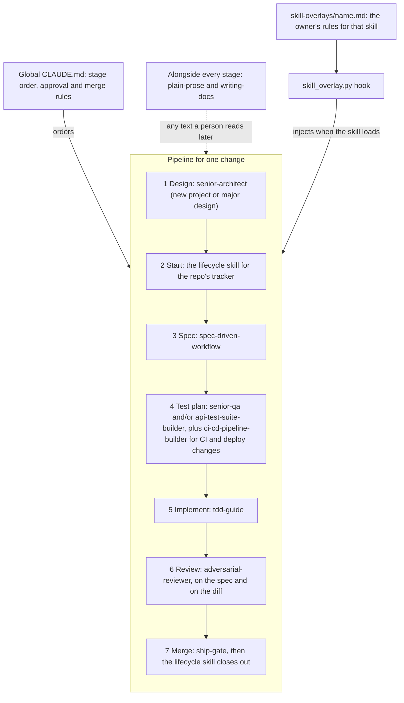

# How the skills fit together

This page explains why the owner's Claude Code configuration is a set of small, separate skills, how the global CLAUDE.md combines them into one development pipeline, and how the owner's own rules reach each skill without editing it. Read it before you add, swap or change a skill. It explains decisions recorded elsewhere: where it disagrees with [`config/SPEC.md`](../../config/SPEC.md) or an [ADR](../adr/), those win.

## The short answer

Each skill does one job: start an issue, write a spec, plan tests, review a change, check a merge. A short global CLAUDE.md, loaded in every session, says which skill runs at which stage and who may approve and merge. The owner's rules for any one skill live in a separate overlay file, which a hook adds to the conversation the moment that skill loads. The skills stay as their authors wrote them, so any one of them can be replaced without rewriting the others.

## The pipeline

Every code change in a repo with an issue tracker goes through the stages below, in this order. Stage 1 runs only for a new project or a major design ([`config/CLAUDE.global.md`](../../config/CLAUDE.global.md), "Pipeline"). Two prose skills run alongside all of them, and a hook injects the matching overlay whenever a skill loads.

Stage 2 and stage 4 are slots, not fixed skills. Stage 2 uses `github-issue-lifecycle` in a repo tracked in GitHub issues, `jira-ticket-lifecycle` in one tracked in Jira, and `gitea-issue-lifecycle` in one tracked on a Gitea server. Stage 4 depends on what the change touches: `senior-qa` for code and `api-test-suite-builder` for HTTP routes, both when a change has both. A change to CI workflows, deploy jobs or the scripts they call also gets `ci-cd-pipeline-builder`, on top of the others.

## Four layers, each holding one kind of rule

The configuration splits its rules by when they need to be in front of Claude. This table follows the design table in [`config/SPEC.md`](../../config/SPEC.md) ("Design: where each kind of rule lives").

| Layer | When it loads | What it holds |
|---|---|---|
| Global CLAUDE.md, `config/CLAUDE.global.md` | Every session | The stage order, who approves and merges, git conventions, and the rule for writing new skills |
| Overlays, `config/skill-overlays/<skill>.md` | When that skill loads, injected by a hook | The owner's policy for one skill: which of its references to read, checklists its plan must show, where the spec is stored |
| Hooks, `config/hooks/*.py` | Run by the Claude Code harness, every time | The rules that must never be skipped: injecting overlays, making every PR merge wait for the owner's click, and stating the machine's default lifecycle skill |
| Skills, `config/skills/` and `config/vendored-skills/` | When a task needs them | The procedure for one job |

A repo's own `CLAUDE.md` sits above all of these for that repo: it wins on commands, paths and conventions.

An example shows how the layers divide the work. `senior-qa` tells Claude to use its testing guides, but before this design it was loaded 127 times while its reference guides were opened about 16 times. Adding more CLAUDE.md text had not fixed that. Its overlay, [`config/skill-overlays/senior-qa.md`](../../config/skill-overlays/senior-qa.md), now arrives at the moment the skill loads and says to read all three guides before any test plan, and lists what the plan must show. The skill's own files are unchanged.

## Why it was built this way

**One job per skill.** The configuration used to have one large custom skill, `issue-spec-driven-workflow`, of about 4,200 words: a copy of the upstream `spec-driven-workflow` skill plus about 2,200 words of GitHub procedure. Because it was a copy, it missed upstream improvements. On 2026-10-15 the owner chose to split it into a lifecycle-only skill and the unmodified upstream spec skill, and to let the CLAUDE.md combine them ("Option B", [`config/SPEC.md`](../../config/SPEC.md), Context, item 4). Every other stage follows the same pattern.

**A short CLAUDE.md.** The CLAUDE.md loads in every session, including ones that have nothing to do with code. The old file had grown to about 11,000 bytes, and roughly 70% of it mattered only while one particular skill was active. Anthropic's guidance is to keep the file under 200 lines because longer files are followed less reliably. So the CLAUDE.md now holds only rules that apply everywhere, and per-skill detail moved into overlays ([`config/SPEC.md`](../../config/SPEC.md), Context, items 1 and 2).

**Overlays instead of edited skills.** When a general CLAUDE.md rule contradicted a loaded skill's own text, Claude tended to follow the skill. A correction that arrives with the skill sits next to the text it overrides, so it wins. Three alternatives lost. Forking each skill to add the owner's policy would drift from upstream again. `@imports` and `rules/` files load at launch, not with the skill. A personal plugin would add packaging work for one user ([`config/SPEC.md`](../../config/SPEC.md), Context, item 3, and the rejected alternatives below its design table).

**Hooks for rules that must hold.** CLAUDE.md text is advice that Claude reads; a hook is code the harness runs. Rules that failed as prose became hooks: the overlay injection, and the merge confirmation, added after a PR was merged without the owner's click. The hooks meet a stricter review bar than other code, because they run on every tool call ([ADR-0007](../adr/0007-visibility-and-security.md)).

**A CLAUDE.md that names no tracker.** The personal and work machines share one CLAUDE.md, but one tracks work in GitHub issues and the other in Jira. So the CLAUDE.md only says "the lifecycle skill for the repo's tracker", and the choice happens elsewhere. The skill comes from the repo's own `CLAUDE.md` if it names one, then from `defaultLifecycle` in `~/.config/claude-config/local.json`, then from the host profile in `hosts/`. The `lifecycle_default.py` hook states the result at the start of every session and subagent ([ADR-0011](../adr/0011-tracker-agnostic-lifecycle.md)).

**Prose rules beside every stage.** Every stage writes text that someone reads later: issues, specs, commits, PRs, code comments, docs. `plain-prose` holds the rules that make such text clear to a reader with no context. `writing-docs` covers the same texts and adds reader-first steps, templates and a lint for documents; it loads `plain-prose` itself. The overlays for `senior-architect` and `runbook-generator` load `writing-docs` before those skills write a document ([ADR-0010](../adr/0010-prose-for-people.md)).

**Specialists that load only when needed.** Some skills fit only certain changes, so loading them for every change would only add noise. The CLAUDE.md lists them on one "rarely self-trigger" line ([`config/CLAUDE.global.md`](../../config/CLAUDE.global.md), "Pipeline"): `migration-architect` and `database-schema-designer` for migrations, `api-design-reviewer` for API changes, `dependency-auditor` for dependency PRs, `runbook-generator` for operations docs, and `agent-workflow-designer` for orchestrating forks.

## Where the skills come from

The skills come from three places, and each place has its own rule for how a skill may change.

- **Maintained here**, in `config/skills/`. These are edited in this repo. A skill gets a `SPEC.md` beside its `SKILL.md` with its first change here, and from then on the spec is updated before the skill ([ADR-0002](../adr/0002-repo-layout.md)). `linux-troubleshooting` hasn't had a change here yet, so it has no `SPEC.md`.
- **Copied whole from upstream**, in `config/vendored-skills/`. These came from the `claude-code-skills` marketplace ([alirezarezvani/claude-skills](https://github.com/alirezarezvani/claude-skills)) when the owner replaced its plugins with copies (#62). They are never edited by hand. A change is either a newer upstream copy or a file adapted only to pass the repo's checks, marked `adapted` in the skill's `VENDORED.json`. A marketplace update can't change them: it reaches them only through a reviewed PR ([ADR-0002](../adr/0002-repo-layout.md), amendments for #62 and #75; [ADR-0007](../adr/0007-visibility-and-security.md), the plugin supply-chain threat, T3).
- **Plugins**, listed under `plugins` in the host profile ([`hosts/personal.json`](../../hosts/personal.json)) and installed by Claude Code itself: `claude-md-management` and `skill-creator`. The repo can't pin what Claude Code installs, so `plugins.lock.json` records the installed versions and `cfg status` reports any change ([ADR-0005](../adr/0005-verification-and-ci.md)). The CLAUDE.md names `skill-creator:skill-creator` for writing skills.

## Every skill

The list comes from `skills` in [`hosts/personal.json`](../../hosts/personal.json); the work machine's profile lists the same skills.

| Skill | Stage or role | Source | Overlay |
|---|---|---|---|
| `senior-architect` | 1 Design | Upstream | Yes |
| `github-issue-lifecycle` | 2 Start and 7 close-out, for GitHub issues | Here | No |
| `jira-ticket-lifecycle` | 2 Start and 7 close-out, for Jira tickets | Here | No |
| `spec-driven-workflow` | 3 Spec | Upstream | Yes |
| `senior-qa` | 4 Test plan, for code | Upstream | Yes |
| `api-test-suite-builder` | 4 Test plan, for HTTP routes | Upstream | Yes |
| `ci-cd-pipeline-builder` | 4 Test plan, for CI and deploy jobs | Upstream | Yes |
| `tdd-guide` | 5 Implement | Upstream | Yes |
| `adversarial-reviewer` | 6 Review | Upstream | Yes |
| `ship-gate` | 7 Merge | Upstream | Yes |
| `plain-prose` | Alongside every stage | Here; four of its scripts and references are upstream copies, listed in its `VENDORED.json` | No |
| `writing-docs` | Alongside every stage | Here | No |
| `migration-architect` | On demand: migrations | Upstream | No |
| `database-schema-designer` | On demand: migrations | Upstream | No |
| `api-design-reviewer` | On demand: API changes | Upstream | No |
| `dependency-auditor` | On demand: dependency and bot PRs | Upstream | No |
| `runbook-generator` | On demand: operations docs | Upstream | Yes |
| `agent-workflow-designer` | On demand: orchestrating forks | Upstream | No |
| `skill-tester` | Writing skills: the CLAUDE.md says "Use `skill-creator:skill-creator`, `skill-tester`, and `skill-security-auditor` (third-party skills, before install)" | Upstream | No |
| `skill-security-auditor` | Writing skills: third-party skills before install, from the same line | Upstream | No |
| `senior-prompt-engineer` | Not named in the CLAUDE.md; loads when its description matches the task | Upstream | No |
| `linux-troubleshooting` | Not named in the CLAUDE.md; loads when its description matches the task | Here | No |
| `fresh-session-handoff` | On demand: the owner asks for a handoff to a fresh session | Here | No |
| `gitea-issue-lifecycle` | 2 Start and 7 close-out, for Gitea issues | Here | No |

## Changing the skill set

Because the pieces are separate, each change touches a known set of files. The commands are in the repo's [`CLAUDE.md`](../../CLAUDE.md), and deploying the result is in the [runbook](../runbook.md).

| Change | Files to touch |
|---|---|
| Add a skill maintained here | `config/skills/<name>/`, with `SPEC.md` written first; the `skills` list in both `hosts/*.json` files, which must stay the same apart from `name` and `defaultLifecycle`; eval suites for it in `eval/gates.json` if its description or body should be tested |
| Add an upstream skill | Run `skill-security-auditor` on it first; copy it whole into `config/vendored-skills/<name>/` with a `VENDORED.json`; both host profiles |
| Give a skill a stage in the pipeline | A line in `config/CLAUDE.global.md` and its row in `eval/clauses.json`; changing the CLAUDE.md requires new `scenario` and `rubric` eval records |
| Change the owner's rules for a skill | `config/skill-overlays/<skill>.md`, named after the bare skill name; this requires a new `scenario` eval record |
| Add or remove a plugin | The `plugins` list in both host profiles, then `python3 -I tools/cfg/lock.py` to rewrite `plugins.lock.json`, in its own `chore(deps)` PR ([ADR-0005](../adr/0005-verification-and-ci.md)) |
| Use another tracker by default | `defaultLifecycle` in the host profile, or in `~/.config/claude-config/local.json` for one machine only, or name the skill in a repo's own `CLAUDE.md` |
| Remove a skill | The reverse of adding it, plus any CLAUDE.md line or overlay that names it |

A change to how claude-config combines the skills, such as the CLAUDE.md, an overlay or a hook, also updates [`config/SPEC.md`](../../config/SPEC.md) in the same PR ([ADR-0002](../adr/0002-repo-layout.md)).

## Trade-offs and limits

- The CLAUDE.md is still advice. Only the three hooks are enforced by the harness, so a stage can still be skipped. The evals catch this in testing, not in a live session.
- Overlays depend on the hook. If no overlay appears when a skill loads, the CLAUDE.md tells Claude to read `~/.claude/skill-overlays/<skill>.md` itself.
- Upstream improvements to a copied skill arrive only when someone copies them in. `python3 -I tools/cfg/lock.py --check` lists upstream files that have changed.
- One change can touch several files, as the table above shows. In exchange, the eval gates in `eval/gates.json` say exactly which checks each file needs.

## Related

- [`config/SPEC.md`](../../config/SPEC.md): the approved spec for the layered CLAUDE.md, overlays and hooks.
- [ADR-0002](../adr/0002-repo-layout.md): where skills, overlays and specs live. [ADR-0010](../adr/0010-prose-for-people.md): the prose skills. [ADR-0011](../adr/0011-tracker-agnostic-lifecycle.md): one lifecycle skill per tracker.
- [Architecture overview](README.md): how the repo deploys this configuration, checks it and rolls it back.
